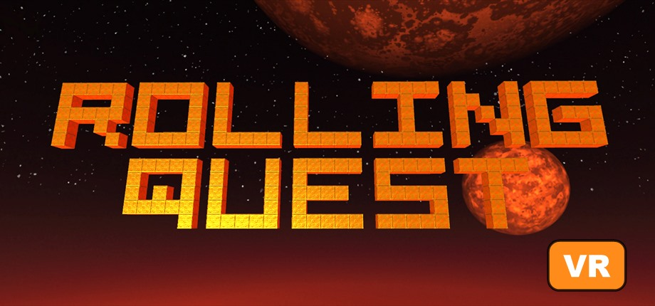

# Rolling Quest VR



A VR mod for **[Rolling Quest](https://krampus1721.itch.io/rollingquest)** by krampus1721, a Kula World–style puzzle game where you roll a ball around floating block levels. Play it in a SteamVR headset in two ways:

- **Follow view:** you ride right behind the ball, the way the game normally plays, in stereo 3D at full headset frame rate.
- **Diorama view:** the level becomes a model on a table in front of you. Push the stick toward where you want the ball to go, and the mod does the turning for you.

Menus and the HUD float on a screen in front of you. The desktop window keeps showing the game, so others can watch.

[](https://ko-fi.com/technewsguy)

## Requirements

- Windows 10/11 (64-bit)
- [Rolling Quest](https://krampus1721.itch.io/rollingquest) (Windows version, tested with v0.3.0.4)
- [SteamVR](https://store.steampowered.com/app/250820/SteamVR/) and a SteamVR headset (tested with a Valve Index)
- One of these controllers:
  - A gamepad (PS4/PS5, Xbox), or the keyboard
  - VR controllers (Index, Touch or Vive)

## Install

1. Download `RollingQuest-VR-v1.0.0.zip` from **[Releases](https://github.com/technewsguy/RollingQuest-VR/releases)**.
2. Unzip everything into the Rolling Quest folder, the one that contains `RollingQuest.exe`.
3. Double-click **`Rolling Quest VR - Add to Steam.bat`**. It:
   - Adds **Rolling Quest VR** to your Steam library and SteamVR library, with cover, header, background, logo and icon art.
   - Puts a **Rolling Quest VR** shortcut on your desktop.
   - Closes Steam while it works, then starts it again.
4. With your headset connected, start **Rolling Quest VR** from Steam, SteamVR or the desktop.

> The **first start takes a minute or two** while BepInEx (the mod loader) prepares the game. It needs an internet connection that one time, to download Unity's base libraries. Later starts are quick.

Starting the game from Rolling Quest VR closes SteamVR's "Resume Game" menu automatically. Your gamepad goes through Steam Input, like any Steam game.

## Controls

The game's own gamepad and keyboard controls work as usual. VR controllers act as a gamepad:

| Index / Touch | Gamepad | Does |
|---|---|---|
| Left thumbstick | Left stick / D-pad | Roll and turn, menus |
| Right A | A / Cross | Jump, accept |
| Right B | B / Circle | Back (menus) |
| Left A (Touch: X) | X / Square | Action |
| Left B (Touch: Y) | Start / Options | Pause |
| Right trigger | R2 | Look up |
| Left trigger | R1 | Look down |
| Left stick click | Share / View (keyboard **F9**) | Switch between follow and diorama view |
| Right stick click | – (keyboard **F8**) | Recenter the view |
| Right thumbstick | Right stick | Diorama: flick left/right to turn the model, up/down to resize |

You can rebind the VR controllers in SteamVR's controller settings for Rolling Quest.

## Diorama view

- **Placement:** the model stays centered on the ball and keeps its direction, so up on the stick always means away from you.
- **Walls:** when the ball rolls up a wall facing you, up and down move it up and down the wall.
- **Turning the model:** flick the right stick left or right.
- **Original controls:** to use the game's turn-then-roll controls in diorama view too, set `PushToSteer = false` in the settings file.

## Settings

Edit `BepInEx\config\rollingquestvr.mod.cfg`, which is created after the first start:

| Setting | Default | Meaning |
|---|---|---|
| `EnableVR` | true | `false` plays the normal flat game |
| `Diorama` | false | Start in diorama view |
| `[Diorama] Size / Distance / Height` | 1.0 / 0.9 / -0.7 | Model width, distance and height, in meters |
| `PushToSteer` | true | Diorama steering (see above) |
| `[UI] Width / Distance / VerticalOffset` | 1.6 / 1.4 / -0.1 | Size and position of the floating menu screen |
| `ShowOnDesktop` | true | Also show menus and HUD in the desktop window |
| `WorldScale` | 1 | Follow view: your size relative to the level |

## Uninstall

1. Double-click **`Rolling Quest VR - Uninstall.bat`** in the game folder. Your saves are kept.
2. Remove **Rolling Quest VR** from Steam: right-click it > *Manage* > *Remove non-Steam game from your library*.

## How it works

Rolling Quest is a Unity 2023 game built with IL2CPP. The mod is a [BepInEx 6](https://github.com/BepInEx/BepInEx) plugin that doesn't use Unity's XR at all:

- **Rendering:** two eye cameras follow the game's camera (or the diorama rig) and render into textures. The mod submits them to SteamVR through [OpenVR](https://github.com/ValveSoftware/openvr).
- **Menus and HUD:** the game's screen-space canvases are redirected into a texture, which floats on a quad in front of you.
- **VR controllers:** they're read through SteamVR Input and fed to the game's Input System as a virtual gamepad.
- **Diorama steering:** a [Harmony](https://github.com/BepInEx/HarmonyX) patch on the game's ball controller turns stick directions into the game's turn and forward inputs.
- **Launcher:** it has SteamVR "launch" a placeholder app, which closes SteamVR's dashboard, then starts the game itself.

### Building

```powershell
.\fetch-deps.ps1                                   # BepInEx 6 be.793 IL2CPP + openvr_api.dll into .\deps
.\build.ps1 -GameDir "C:\path\to\Rolling Quest"    # needs BepInEx installed there and the game started once
.\make-release.ps1 -Version 1.0.0                  # dist\RollingQuest-VR-v1.0.0.zip
```

## Credits

- **Rolling Quest** © krampus1721. This is an unofficial fan mod. The artwork in `art/` is made from the game's own images (its itch.io page and in-game logo) and belongs to its developer. Please support the game: <https://krampus1721.itch.io/rollingquest>
- [BepInEx](https://github.com/BepInEx/BepInEx) (LGPL-2.1), bundled in the release zip, with [Il2CppInterop](https://github.com/BepInEx/Il2CppInterop) and [HarmonyX](https://github.com/BepInEx/HarmonyX)
- [OpenVR](https://github.com/ValveSoftware/openvr) by Valve (BSD-3-Clause)

The mod's own code is under the [MIT License](LICENSE).
